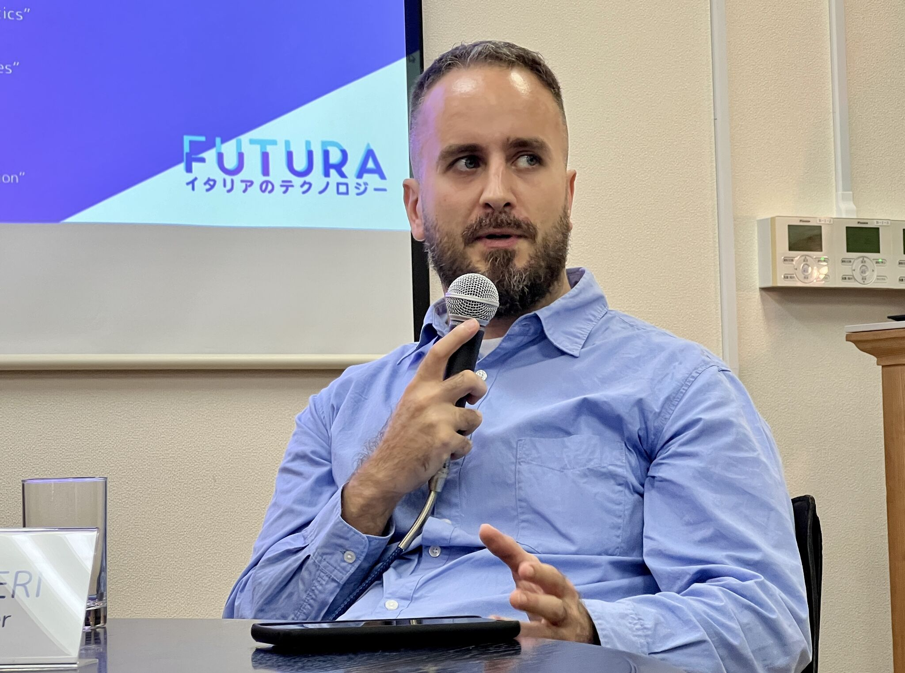

## Talk at ICCJ
Manuel was invited to give an overview of his work in AI for a tech event, [FUTURA](https://futura.iccj.or.jp), at the [Italian Chamber of Commerce in Japan](https://iccj.or.jp).

The talk gave a very high level introduction to ideas driving Manuel's research in the foundations of AI, with the goal to build reliable, trustworthy and agentic systems that can be deployed in real-world scenarios.

Presentation material (PDF) available [here](/assets/pdf/presentations/ICCJ2024.pdf).
