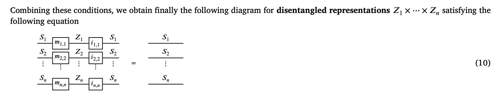
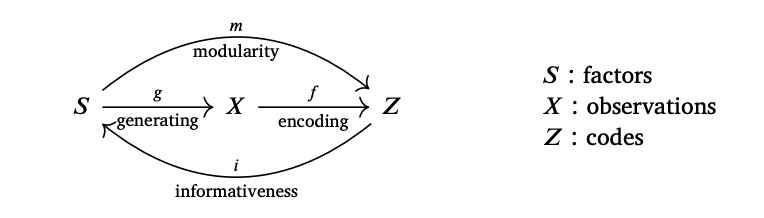
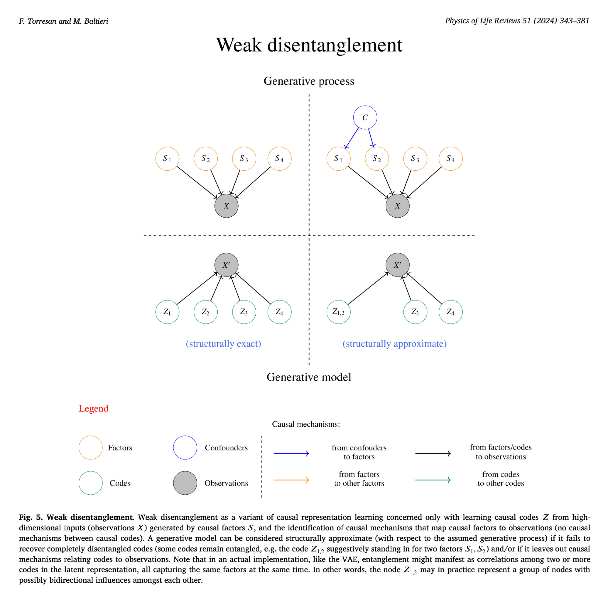
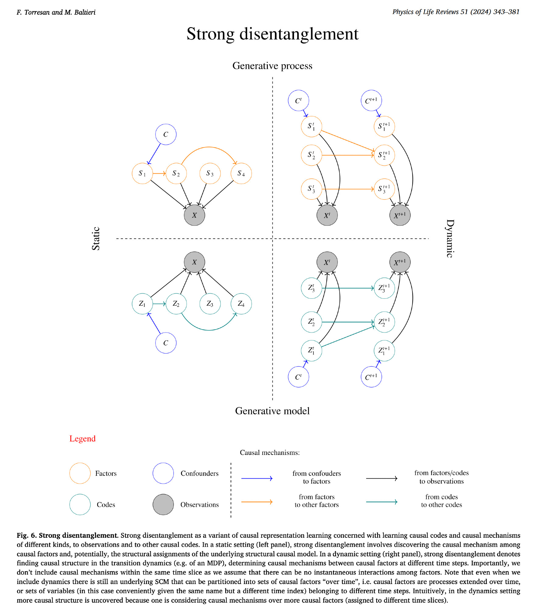
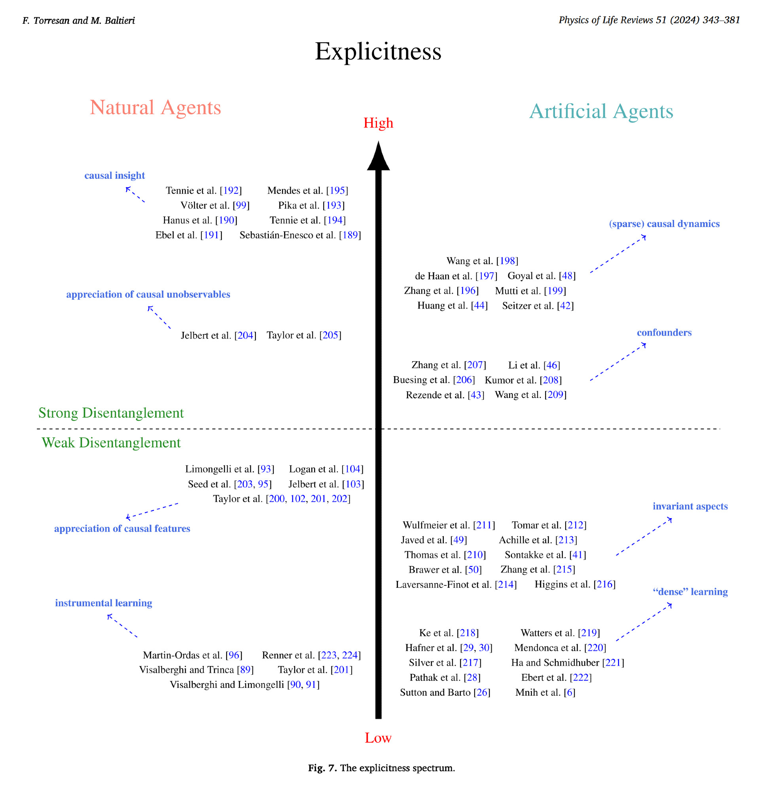
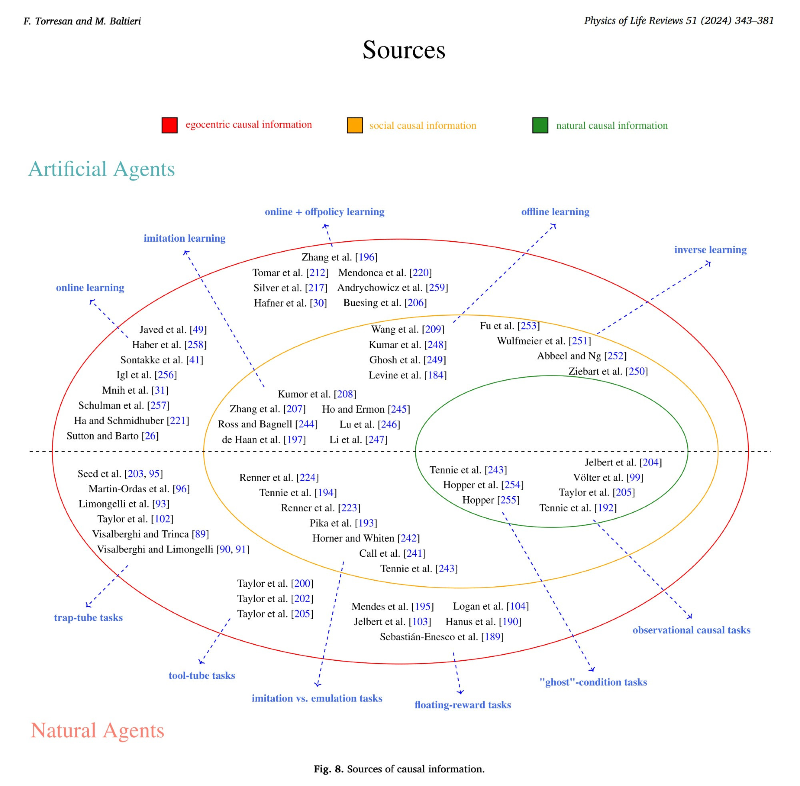
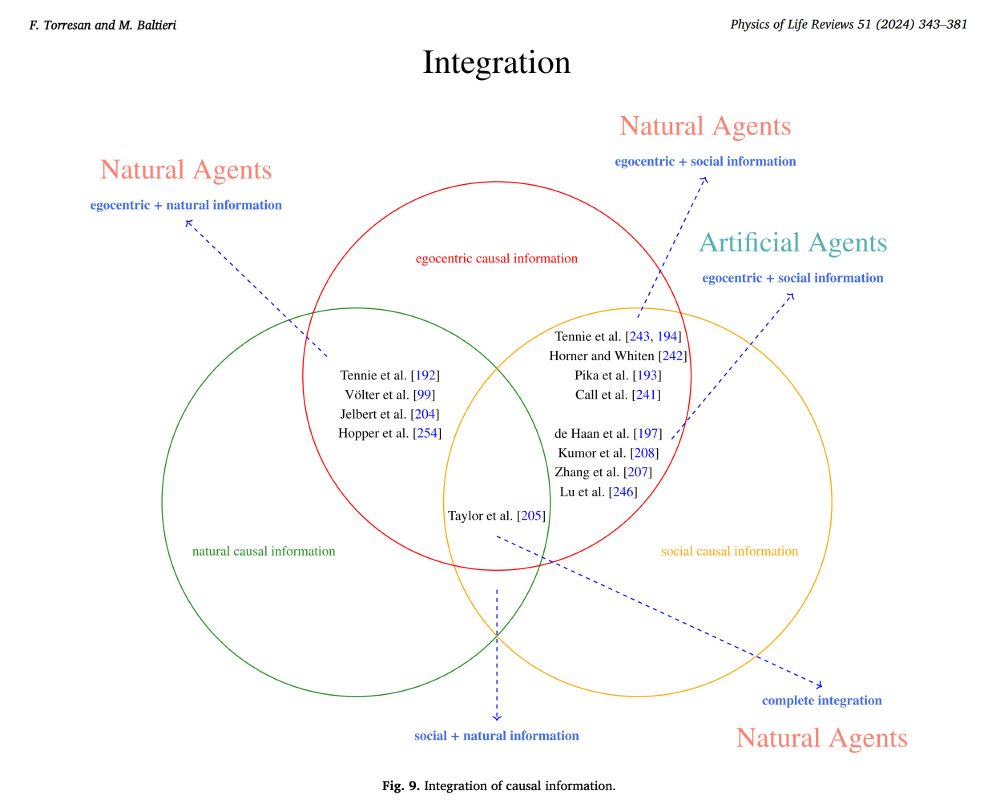

# Disentangled representations for causal cognition
Our paper is now published in [Physics of Life Reviews](https://www.sciencedirect.com/science/article/pii/S1571064524001295) and available [here](/assets/pdf/DisentanglementCausalCognition.pdf). Work led by Filippo Torresan and Manuel.

- **Disentangled Representations for Causal Cognition**, Torresan, F. & Baltieri, M., *Physics of Life Reviews* (2024).

&nbsp;
&nbsp;

The paper proposes a computational framework for causal cognition in natural and artificial agents, drawing from recent work in causal machine learning,

in part based on recent developments of Markov categories in applied category theory to explain representation learning,

and reinforcement learning.

Causality has long been viewed as a key ingredient of intelligence, but there is still no consensus on how to design a causal agent, e.g. one capable of climbing the "causality ladder".
In the paper, we review the rich literature on causal cognition in non-human animals to single out the most common traits of natural causal agents, as studied in many behavioural experiments and we describe three dimensions of causal cognition that have recently emerged as canonical: the (1) explicitness, (2) sources, and (3) integration of causal information, see Tobias Starzak & Russel Gray’s [work](https://link.springer.com/article/10.1007/s10539-021-09779-1).

In the second half of the paper, we relate these aspects of causal cognition to research on disentangled representations, particularly with respect to causal representation learning.
By proposing a distinction between weak

and strong disentanglement approaches,

causal agents can be placed on an explicitness spectrum depending on much environmental causal structure can acquire,

e.g. identifying key causal features and/or causal relationships among objects, like the fact that the shape of a ball can make a difference for whether it bounces but its colour does not.

We speculate that a higher level of explicitness is conducive to better integration of causal information from different sources, i.e., improvements with respect to the other two dimensions.
Sources 

and integration 

are discussed by examining more closely works on reinforcement learning (RL), with the goal of drawing a comparison between artificial and natural agents in causal tasks.

While deep RL has made enormous progress in the last decade, it is still unable to deliver agents with a sound and robust casual perspective of themselves and the environment around them.
We think that a research programme investigating how RL agents can be improved with tools from causality research and how they can be benchmarked with tests inspired from experimental works on animal causal cognition (see for example the [Animal AI Olympics](https://www.nature.com/articles/s42256-019-0050-3)) is worth pursuing as it has the potential to contribute towards the next milestones in the study of natural and artificial intelligence.
