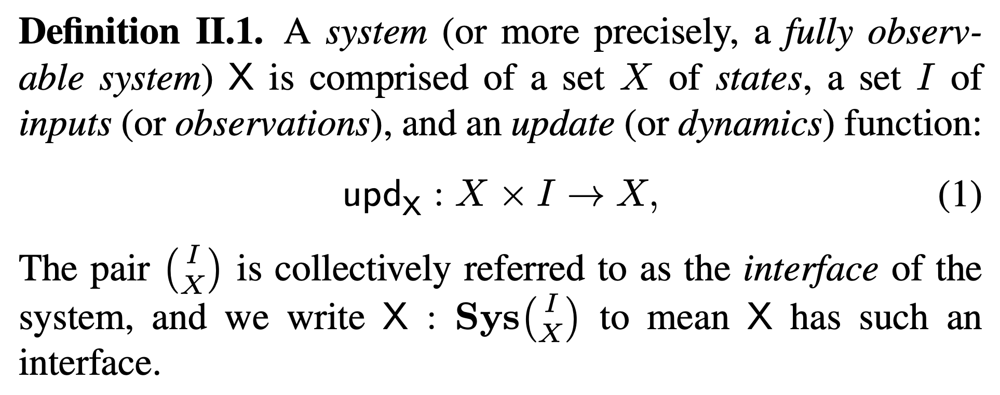
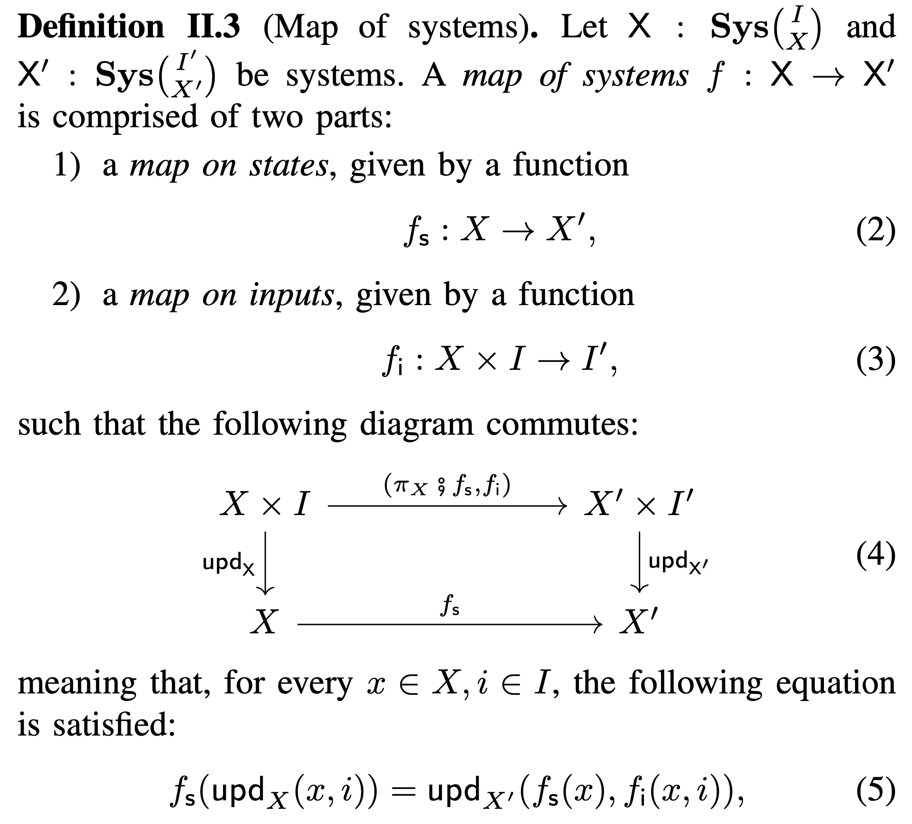
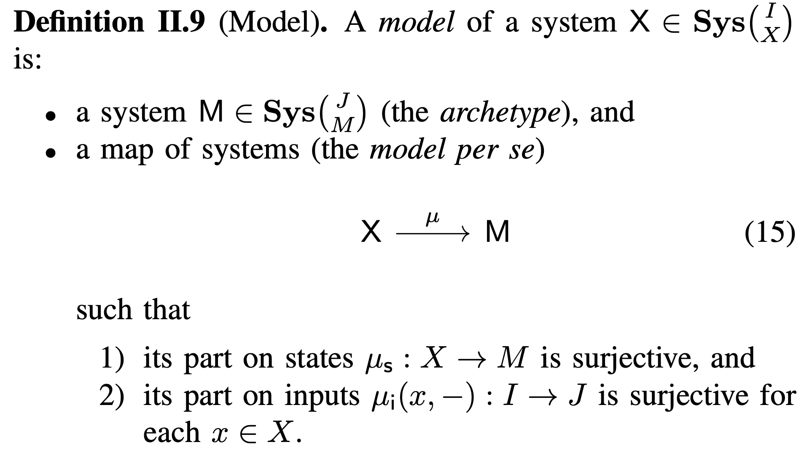
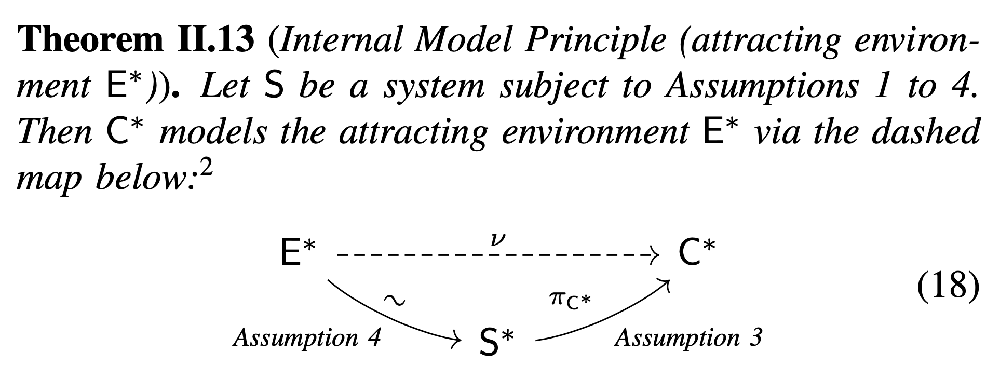
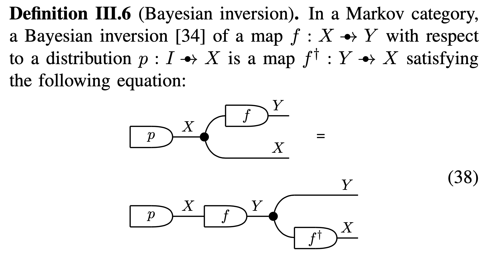
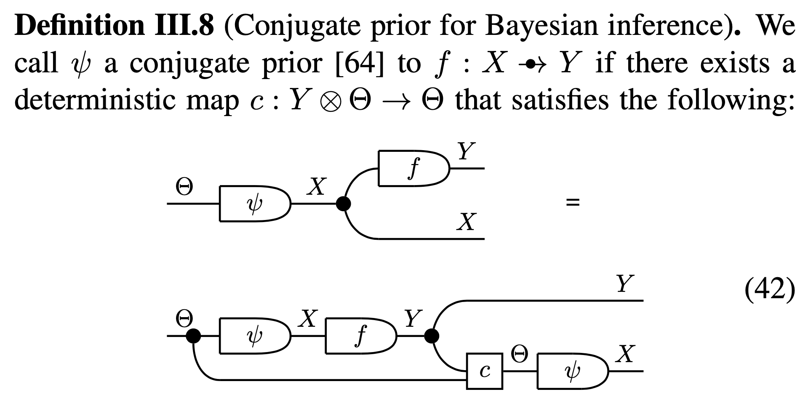
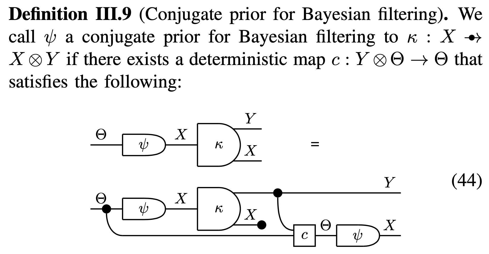
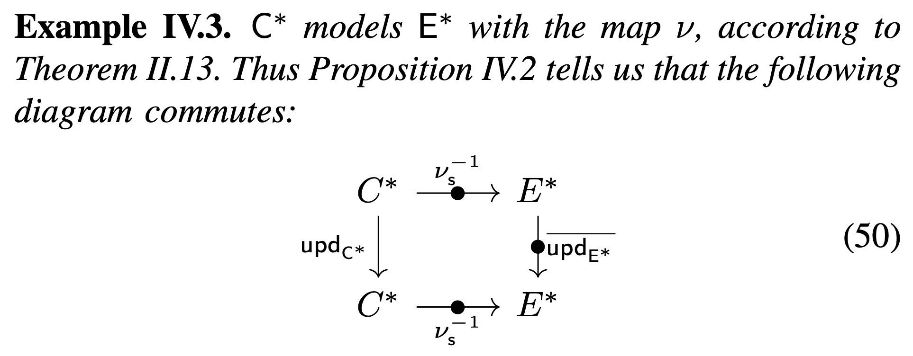
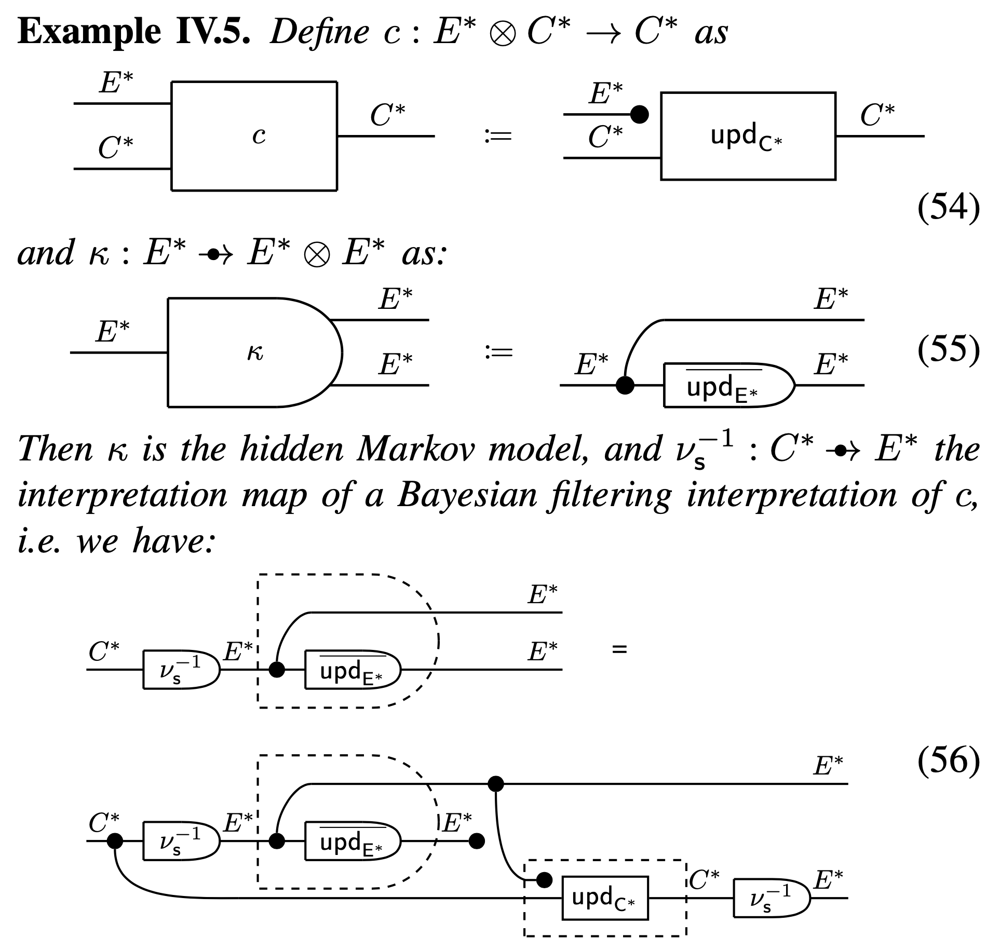

# A Bayesian Interpretation of the Internal Model Principle
Our paper is now available [here](/assets/pdf/BayesianIMP.pdf). Work with Martin Biehl, Matteo Capucci and Nathaniel Virgo.

- **A Bayesian Interpretation of the Internal Model Principle**, Baltieri, M., Biehl, M. Capucci, M. & Virgo, N. *arXiv pre-print arXiv:2503.00511* (2025).

&nbsp;
&nbsp;

This work combines ideas from control theory, applied category theory and Bayesian reasoning, with ramifications for cognitive science, AI/ML, ALife and biology to be further explored in the future.

In these fields, we come across ideas of “models”, “internal models”, “world models”, etc. but it is hard to find formal definitions, and when one does, they usually aren’t general enough to cover all the aspects these different fields consider important.

In this work, we focus on two specific definitions of models, and show their connections. One is inspired by work in control theory, and one comes from Bayesian inference/filtering for cognitive science, AI and ALife, and is formalised with Markov categories.

In the first part, we review and reformulate the “internal model principle” from control theory (at least, one of its versions) in a more modern language heavily inspired by categorical systems theory (see [David Jaz Myers' draft book](https://www.davidjaz.com/Papers/DynamicalBook.pdf) and [Matteo Capucci's notes](https://github.com/mattecapu/categorical-systems-theory/blob/master/main.pdf)).

We review the original work by Wonham and collaborators, and unpack some of its implicit assumptions, finding that at least one of them requires more attention (we also have a result that doesn’t require it, and may end up in a revised version or a future work). We also get to a definition of “models” for non-autonomous (fully observable) systems that already generalises the original one for autonomous systems. We do however only focus on the autonomous case for its importance in the literature, with further explorations left to future work.

The internal model principle is arguably one of the most influential outputs of control theory, claiming, at its core, that if a controller regulates a plant against disturbances from the environment, it does so by implementing a model of the environment.

This is often taken to be 1) a better formalisation of Conant&Ashby’s good regulator “theorem”, and 2) the reason why talking about “internal models” is necessary in cognitive science, AI/ML/RL, biology and neuroscience.
 
Our focus here is mostly technical and has to do almost entirely with control theory, but considering where the conversation started: https://x.com/manuelbaltieri/status/1230386566066884608, the hope is that this will have an impact also in the cognitive and life sciences.

In the second part of the paper, we use results from a recent line of work started by some of Manuel's collaborators on how to interpret a physical system as performing Bayesian inference, or filtering, using the language of Markov categories (~ category theory applied to the study of different forms of nondeterministic processes): https://link.springer.com/chapter/10.1007/978-3-030-93736-2_52.

After a reasonably self contained overview of the formal graphical language (string diagrams) used to represent Markov categories, and some definitions including Bayesian inference and filtering, their parametrised and conjugate prior versions, we dive into the main result, showing mainly two things.

Firstly, we show that the definition of model between two autonomous system can be “reversed” to build a “possibilistic” version of the internal model principle.

We then show how this corresponds to a Bayesian filtering interpretation for a reasoner: how a controller modelling its environment can be understood as performing Bayesian filtering on its environment. Importantly, this makes use of the fact that we have a Markov category, Rel^+, of possibilistic Markov kernels that can be used to specify beliefs as (sub)sets without assigning them probabilities, but that works very much like other “nice” Markov categories.

Secondly, we discuss how this form of Bayesian filtering is quite simplistic, 1) not making full use of Bayesian updates by ignoring observations from the environment/plant, and 2) assuming that beliefs of equicredible states of the environment are disjoint (they form a partition).
